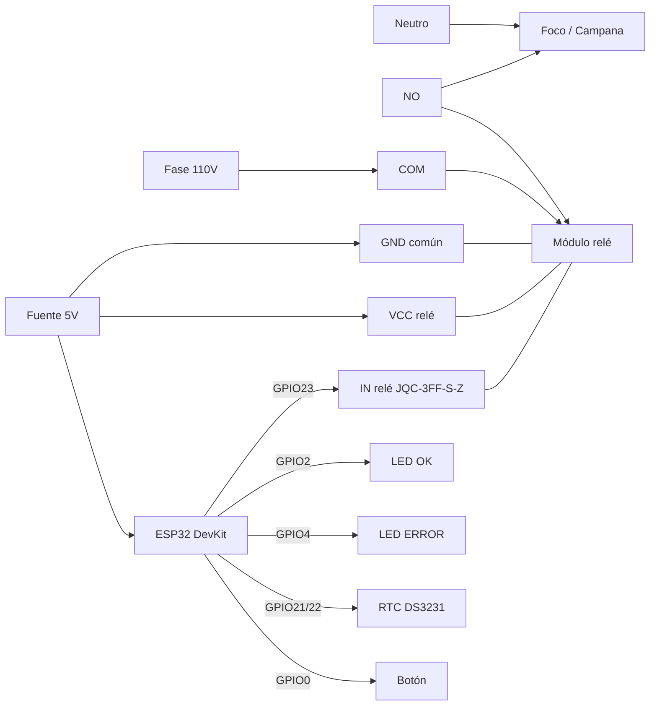
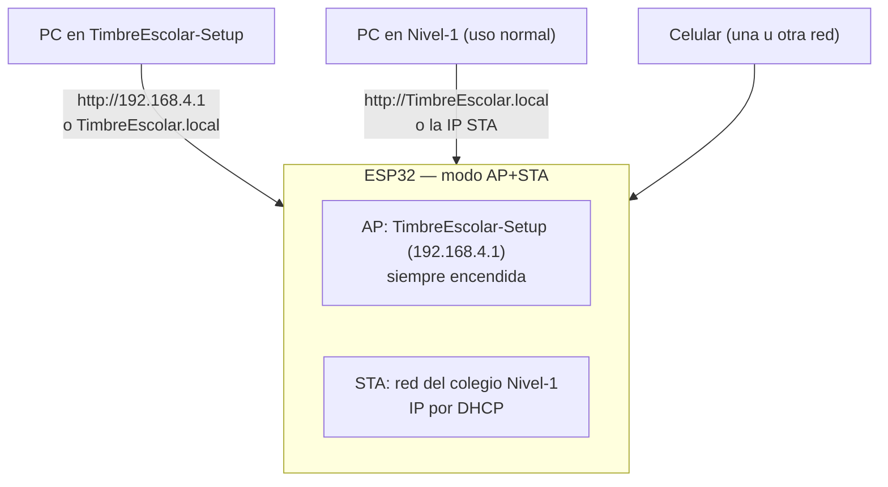

# Diagrama de conexiones — Timbre Escolar Inteligente

Guía de cableado físico y de red del timbre. El relé controla un foco o
campana de 110 V en serie con la línea. **Trabaja con la corriente apagada.**

## Hardware

| ESP32 | Conecta a | Detalle |
|-------|-----------|---------|
| GPIO23 | IN del módulo relé | Señal de control (HIGH = relé activo) |
| 5V | VCC del módulo relé | Módulo JQC-3FF-S-Z activo en HIGH |
| GND | GND del módulo relé | Tierra común |
| GPIO2 | LED OK | Indicador de operación normal |
| GPIO4 | LED ERROR | Indicador de falla |
| GPIO21 | SDA del RTC DS3231 | Reloj de tiempo real |
| GPIO22 | SCL del RTC DS3231 | Reloj de tiempo real |
| GPIO0 | Botón RESET | Pulsador a GND |
| 5V / GND | Fuente USB o fuente 5V | Alimentación de la tarjeta |

> ⚠️ El foco/campana va a **110 V**. El módulo relé aísla el circuito de baja
> tensión del circuito de fuerza: conecta **COM** a la fase y el otro extremo
> del foco al neutro, sin tocar los pines del ESP32 con 110 V.

## Red / WiFi (modo AP+STA)

El timbre opera en **dos redes a la vez**:

| Modo | Red | IP | Para qué sirve |
|------|-----|----|----------------|
| AP (siempre encendida) | `TimbreEscolar-Setup` | `192.168.4.1` | Respaldo: setup/fábrica, o si la red del colegio se cae |
| STA (red del colegio) | `Nivel-1` | DHCP (ej. `192.168.0.x`) | Uso normal: la app se conecta sin cambiar de red |

### Cómo encuentra la app al timbre

1. `http://192.168.4.1` — si el PC está en la red propia del timbre.
2. `http://TimbreEscolar.local` — **uso normal**: si el PC/celular está en la
   red del colegio (Nivel-1), la app se conecta por esta vía sin cambiar de red.
3. URL manual en *Ajustes → URL del dispositivo* — si el colegio bloquea mDNS,
   se fija la IP del timbre en la red escolar.

### Notas

- Si el WiFi del colegio se cae, el timbre **sigue sonando** con su horario
  (scheduler local + RTC) y vuelve a unirse solo cuando la red vuelve.
- Al conectar el STA, el punto de acceso propio puede cambiar de canal
  (el ESP32 comparte radio) — los clientes conectados se reconectan solos.
- Las credenciales de `Nivel-1` viven solo en `firmware/src/config.h` de tu PC
  (protegido con `skip-worktree`); el repo conserva valores de ejemplo.
